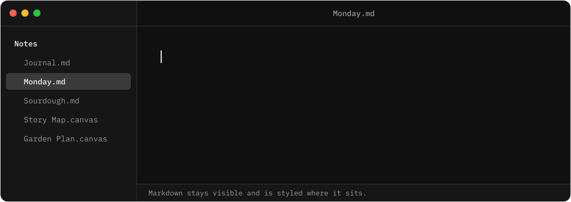
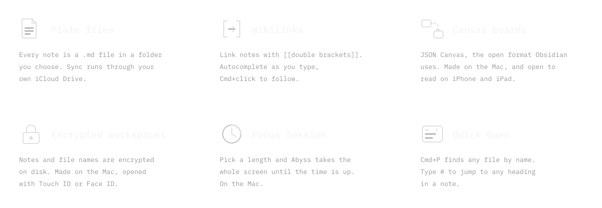
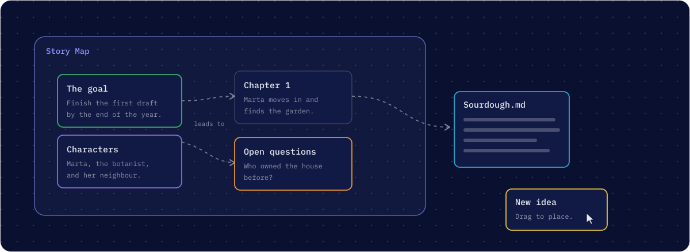

<picture>
  <source media="(prefers-color-scheme: dark)" srcset="assets/hero-dark.svg">
  <source media="(prefers-color-scheme: light)" srcset="assets/hero-light.svg">
  
</picture>

Abyss is a native Markdown editor for Mac, iPhone and iPad. Your notes are plain `.md` files in folders you choose, styled where they sit as you type. It is free, with no trial, subscription or in-app purchases.

## Write

<picture>
  <source media="(prefers-color-scheme: dark)" srcset="assets/typing-dark.svg">
  <source media="(prefers-color-scheme: light)" srcset="assets/typing-light.svg">
  
</picture>

You type Markdown and see it styled in place. The characters stay visible, so what you read is what is in the file. Abyss bundles IBM Plex Mono, Sans and Serif, and its light and dark themes follow the system.

## What is inside

<picture>
  <source media="(prefers-color-scheme: dark)" srcset="assets/features-dark.svg">
  <source media="(prefers-color-scheme: light)" srcset="assets/features-light.svg">
  
</picture>

On the Mac you can export a note to PDF, HTML, Rich Text or Word, and a board to PNG or PDF. Handoff carries a note between your devices with the caret where you left it.

## Think on a canvas

<picture>
  <source media="(prefers-color-scheme: dark)" srcset="assets/canvas-dark.svg">
  <source media="(prefers-color-scheme: light)" srcset="assets/canvas-light.svg">
  
</picture>

Boards are created and edited on the Mac. On iPhone and iPad they open read-only, and you can pan, zoom and double-tap a card to read it in full. Boards from an Obsidian vault open as they are.

## Your files, your folders

Abyss keeps no database. A note is a `.md` file, and it syncs, if you want it to, through your own iCloud Drive. The App Store privacy label for Abyss says Data Not Collected.

## Get Abyss

| | |
|---|---|
| Mac | macOS 15 or later, Apple silicon |
| iPhone and iPad | iOS 18 or iPadOS 18 or later |
| Where | [App Store](https://apps.apple.com/app/id6820560837), listed as Abyss Writer. One listing covers all three. |
| Website | [abyss.md](https://abyss.md) |
| Support | [abyss.md/support](https://abyss.md/support) or hello@abyss.md |

## Bugs and ideas

Bug reports and feature requests go to [abyssmd/abyss](https://github.com/abyssmd/abyss/issues).

## Elsewhere

[X](https://x.com/abyss_md) · [Threads](https://www.threads.com/@abyss.md) · [Bluesky](https://bsky.app/profile/abyssmd.bsky.social) · [Mastodon](https://mastodon.social/@abyssmd) · [Instagram](https://www.instagram.com/abyss.md) · [r/AbyssMD](https://www.reddit.com/r/AbyssMD)

<picture>
  <source media="(prefers-color-scheme: dark)" srcset="assets/footer-dark.svg">
  <source media="(prefers-color-scheme: light)" srcset="assets/footer-light.svg">
  
</picture>

Abyss is a hobby project by Peter Mukhortov, a solo developer in Helsinki.

